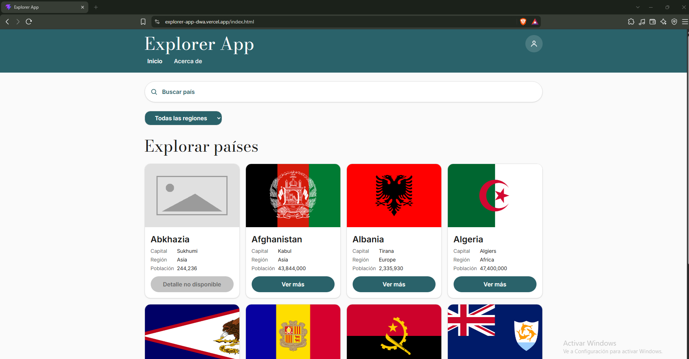

# Explorer App

Aplicación para explorar información de países: búsqueda por nombre, filtro por región, vista de detalle con navegación tipo SPA (hash routing), y manejo de los estados de carga, vacío y error. Construida con **Vite + TypeScript (Vanilla, sin frameworks) + Tailwind CSS v4**, organizada en módulos por responsabilidad.

Esta es la **versión Vanilla TypeScript** del proyecto.

## Demo en producción

**https://explorer-app-dwa.vercel.app**

Desplegada en Vercel desde la rama `main` del repositorio.



## Fuente de datos

[REST Countries API v5](https://restcountries.com/docs) (`https://api.restcountries.com/countries/v5`). La petición se autentica con una API key enviada en el header `Authorization: Bearer`, y se pagina con `limit`/`offset` hasta obtener el catálogo completo de países.

No se utilizó el JSON de contingencia facilitado por la docente: la aplicación consume la API en vivo mediante `fetch`, con tipado explícito de la respuesta y manejo de errores (sin uso de `any` en ningún archivo del proyecto).

## Cómo ejecutar el proyecto

> **Importante:** el proyecto vive dentro de la carpeta `Explorer-app/` del repositorio, no en la raíz. Todos los comandos siguientes deben ejecutarse desde ahí.

### 1. Clonar el repositorio y entrar a la carpeta del proyecto

```bash
git clone https://github.com/Javviee/Explorer-APP---DWA.git
cd Explorer-APP---DWA/Explorer-app
```

### 2. Instalar dependencias

```bash
pnpm install
```

### 3. Configurar la API key

Copia el archivo de ejemplo `.env.example` como `.env` (en la misma carpeta, junto a `package.json`):

```bash
cp .env.example .env
```

En Windows PowerShell: `Copy-Item .env.example .env`.

Luego edita `.env` y reemplaza el valor ficticio por tu propia key de REST Countries:

```
VITE_REST_COUNTRIES_API_KEY=tu_api_key_aqui
```

El archivo `.env` está en `.gitignore` y no se sube al repositorio. Ten en cuenta que las variables `VITE_*` quedan expuestas en el navegador, por lo que no son un almacén de secretos: en REST Countries restringe la key a tus dominios (CORS Allowed Origins).

### 4. Levantar el servidor de desarrollo

```bash
pnpm dev
```

Abre la URL que indique la terminal (por defecto `http://localhost:5173`).

### 5. Build de producción

```bash
pnpm build
```

Genera la carpeta `dist/` lista para desplegar.

### 6. Probar la versión construida

```bash
pnpm preview
```

Sirve el contenido de `dist/` (normalmente en `http://localhost:4173`) para comprobar la versión de producción en local.

### Variables de entorno

| Variable | Descripción |
|---|---|
| `VITE_REST_COUNTRIES_API_KEY` | API key de REST Countries. Plantilla en `.env.example`, sin valor real. |

En Vercel se configura en **Project Settings → Environment Variables** (Production y Preview). Si cambias una variable después del build, genera un nuevo deployment.

## Estructura de carpetas

```
Explorer-app/
├── .env.example            Plantilla de variables de entorno (sin valores reales)
├── index.html              Punto de entrada único (SPA)
├── public/
│   ├── favicon.svg
│   └── placeholder.png     Imagen de respaldo cuando una bandera no está disponible
├── design-reference/
│   └── mobile/             Capturas del diseño original de Figma (mobile)
├── src/
│   ├── main.ts             Orquestador: coordina módulos, eventos, router por hash
│   ├── style.css           Import de Tailwind + Design Tokens (@theme) + tipografía fluida
│   ├── vite-env.d.ts       Tipado de variables de entorno
│   ├── api/
│   │   └── countries.ts    Peticiones fetch tipadas a REST Countries (listado + detalle por código)
│   ├── types/
│   │   ├── country.ts      Interfaces Country, CountriesResponse, etc.
│   │   └── countryDetails.ts  Interfaz CountryDetails (extiende Country) con campos opcionales
│   ├── utils/
│   │   ├── format.ts       Formateo de población, capital, idiomas, monedas, escape de HTML
│   │   ├── filters.ts      Función pura de filtrado por nombre + región
│   │   └── debounce.ts     Debounce genérico y tipado (300 ms en la búsqueda)
│   └── render/
│       ├── countryCard.ts  Tarjeta individual de país
│       ├── countryGrid.ts  Grilla de tarjetas (map + join)
│       ├── details.ts      Vista de detalle de un país
│       └── states.ts       Estados de UI: loading (skeleton), empty, error
└── vite.config.ts
```

## Funcionalidad implementada

- **Búsqueda por nombre** (insensible a mayúsculas/minúsculas) con **debounce de 300 ms**.
- **Filtro por región**, aplicado de inmediato (sin debounce) y combinable con la búsqueda — limpiar uno conserva el otro.
- **Estados de interfaz**:
  - *Carga*: 8 tarjetas skeleton con `animate-pulse`.
  - *Vacío*: mensaje indicando que no hay coincidencias para el término buscado.
  - *Error*: alerta visual con botón "Reintentar" cuando falla la petición (distinto del estado vacío).
- **Vista de detalle** por país vía hash (`#/country/SV`), sin recargar la página, con botones de navegación atrás/adelante del navegador funcionando.
- **Manejo de datos ausentes**: bandera no disponible → `placeholder.png` (vía `onerror` y fallback `||`); país sin código → tarjeta sin enlace de detalle ("Detalle no disponible").
- **Tarjetas adaptables** con Container Queries (`@container`, `@min-[20rem]:`) y tipografía fluida con `clamp()`.

## Stack técnico

- [Vite](https://vite.dev/)
- TypeScript (Vanilla, sin frameworks de UI)
- [Tailwind CSS v4](https://tailwindcss.com/) (`@tailwindcss/vite`), Design Tokens vía `@theme`
- [REST Countries API v5](https://restcountries.com/docs)

## Flujo de trabajo y despliegue (GitHub Flow + Vercel)

- `main` es la rama de producción y está protegida: los cambios llegan mediante Pull Request.
- Cada PR genera una preview en Vercel que se revisa antes de integrar.
- Al integrar en `main`, Vercel despliega a producción (URL en la sección *Demo en producción*).
- Los commits siguen la convención Conventional Commits (`feat:`, `fix:`, `refactor:`, `docs:`).
- PR de S19 integrado: [#2 docs: agregar .env.example y documentar su uso en el README](https://github.com/Javviee/Explorer-APP---DWA/pull/2)

## Limitaciones conocidas

- **Restricción de orígenes en la API key:** la key solo responde a los dominios listados en *CORS Allowed Origins* de REST Countries. Cada dominio nuevo (por ejemplo, la preview de una rama) debe agregarse manualmente; de lo contrario la API responde `403` y la app muestra el estado de error.
- **La key es visible en el navegador:** las variables `VITE_*` se incluyen en el código del cliente, por lo que se protege restringiendo la key por dominio, no ocultándola.
- **Cuota de la API:** el plan gratuito tiene un límite mensual de peticiones y cada carga completa del catálogo realiza varias peticiones paginadas (sin caché). Si se agota la cuota, la app mostrará el estado de error.
- **Datos incompletos de la API:** algunos territorios no tienen bandera o código alfa-2 (por ejemplo, Abkhazia); se muestra una imagen de respaldo y la tarjeta indica "Detalle no disponible".
- **Detalle de país:** los países fronterizos se muestran como códigos alfa-3 (por ejemplo, `GTM`), y monedas e idiomas aparecen tal como los devuelve la API (en inglés).
